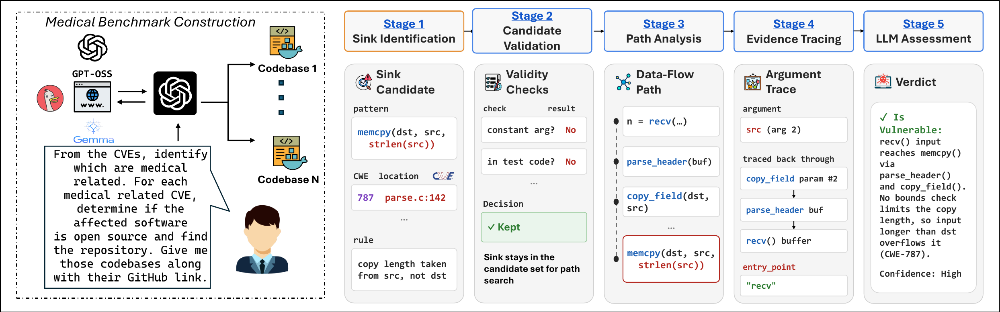

# REPAIR

Two vulnerability-candidate pipelines, one for C/C++ and one for Java. Each takes a codebase and a CWE and outputs candidate vulnerable locations, with an LLM exploitability verdict on each.



## CWEs covered

17 CWE categories: CWE-20, 22, 78, 79, 94, 121, 122, 126, 129, 134, 415, 416, 457, 476, 611, 680, and 787.

## LLM endpoint / API key setup

Copy `config.example.json` to `config.json` (repo root) and fill in your endpoint, model, and API key — `config.json` is gitignored,
so it never gets committed. Both pipelines read it automatically and use it as their `--endpoint`/`--model`/`--api-key` defaults; CLI
flags, when given, always override it. Set values under `"cpp"` / `"java"` to target each pipeline differently, or under `"default"`
to share one setup across both. Works the same way for a local vLLM server or a hosted/proprietary model endpoint.

## Running — C / C++

```bash
cd cpp_pipeline
python3 -m venv .venv && . .venv/bin/activate && pip install -r requirements.txt

python pipeline.py run --codebase /path/to/code --cwe CWE-121 --cwe CWE-476 \
    --include-dir src --harness none \
    --endpoint http://127.0.0.1:8001/v1 --model meta-llama/Llama-3.1-8B-Instruct \
    --output out/
```

`python pipeline.py --help` (and `run --help`) for all options.

## Running — Java

```bash
cd java_pipeline && ./setup.sh

MEDICALJAVA_ALLOW_LLM=1 .venv/bin/python -m pipeline.run analyze --codebase /path/to/java/repo --cwe CWE-22 \
    --out out/ --endpoint http://127.0.0.1:8002/v1 --model openai/gpt-oss-20b
```

`python -m pipeline.run --help` for all options.
